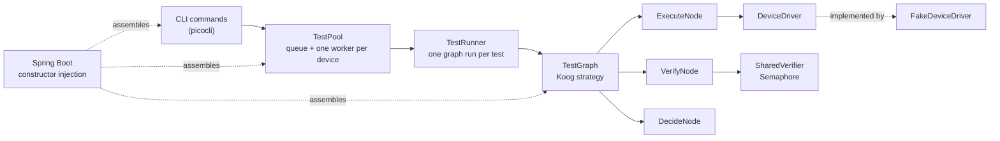
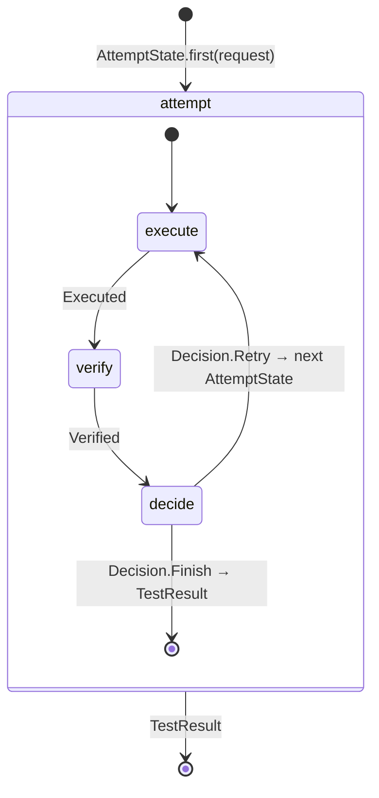
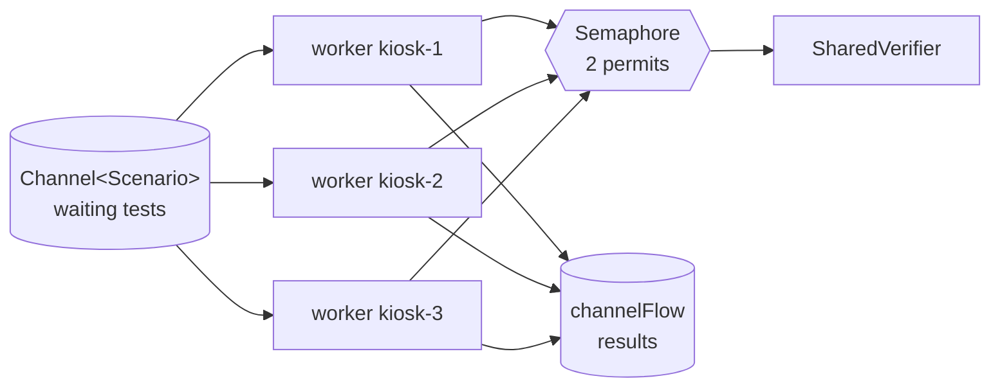

# kotlinfest2026-koog-e2e

A minimal, runnable study of how an end-to-end test harness can be composed from **typed Koog graphs**, **Spring Boot dependency injection**, a **`DeviceDriver` abstraction**, and **structured concurrency with Kotlin Coroutines**.

> [!IMPORTANT]
> **Disclaimer.** This is a deliberately simplified, educational project. It exists to convey design ideas, not to serve as a production harness. Real devices and LLM calls are replaced by deterministic fakes, and everything that is not needed to explain the design has been removed. It accompanies a KotlinFest 2026 talk and is not a product.

## Abstract

An end-to-end test on a device is slow, occasionally flaky, and often judged by a shared, rate-limited service such as an LLM. This sample isolates the four design decisions that keep such a harness understandable:

1. **A typed retry loop as a subgraph.** Execute → verify → decide is one Koog subgraph. The attempt budget is plain data on its edges, not hidden state.
2. **A device seam.** The graph speaks to one interface, `DeviceDriver`. A scripted fake makes every failure mode reproducible.
3. **Two kinds of test.** Graph *topology* is asserted without running a scenario; graph *behavior* is asserted by running the real graph on the fake.
4. **Bounded shared work, unbounded device work.** One worker per device drains a queue; only the shared verifier is throttled by a semaphore.

## Scope

| In scope | Out of scope (removed on purpose) |
|---|---|
| Spring Boot as a CLI composition root | Real devices and any device automation backend |
| Koog typed strategy graph and subgraph | Real LLM calls, API keys, structured output |
| `DeviceDriver` with one fake implementation | Specification parsing, scenario generation |
| Koog graph-testing feature, behavior tests | UI-tree handling, element location, self-repair |
| `Channel`, `channelFlow`, `Semaphore`, `delay` | Persistence, reports, dashboards, tracing |

## Requirements

- JDK 21
- Network access on the first build (Gradle downloads dependencies from Maven Central)

Versions: Kotlin 2.3.21, Spring Boot 3.5.6, Koog 1.1.1, kotlinx-coroutines 1.11.0.

## Quick start

```sh
./harness doctor     # check the environment and the wiring
./harness list       # scenarios and fake devices
./harness run        # run every scenario across three fake devices
./gradlew test       # structure, behavior and concurrency tests
```

`./harness` builds the jar on first use and then runs it. Without the script: `./gradlew bootJar && java -jar build/libs/harness.jar run`.

### Commands

| Command | Purpose |
|---|---|
| `run [-s ID]... [--max-attempts N]` | Run scenarios across the fake devices. Exit code 0 if all passed, 1 otherwise. |
| `list` | List the scenarios, how the fake device answers each, and the devices. |
| `graph` | Print the test graph as Mermaid, generated by Koog from the real strategy. |
| `doctor` | Check the JDK, the configuration, each device, and one probe test end to end. |
| `help [COMMAND]` | Show usage. `--help` works on every command. |

Sizing is configuration, read by Spring Boot from [`application.yml`](src/main/resources/application.yml) or the environment:

```sh
HARNESS_DEVICES=5 HARNESS_VERIFIER_PERMITS=1 ./harness run
```

| Variable | Default | Meaning |
|---|---|---|
| `HARNESS_DEVICES` | 3 | Fake devices, one worker each |
| `HARNESS_VERIFIER_PERMITS` | 2 | Shared verifications in flight at once |
| `HARNESS_MAX_ATTEMPTS` | 3 | Attempts per test, the first included |
| `HARNESS_DEVICE_LATENCY` | 300ms | How long a fake device takes to act |
| `HARNESS_VERIFIER_LATENCY` | 500ms | How long the shared verifier takes |

## Architecture



| Box | Code |
|---|---|
| CLI commands | [`cli/`](src/main/kotlin/harness/cli) |
| TestPool | [`pool/TestPool.kt`](src/main/kotlin/harness/pool/TestPool.kt) |
| TestRunner, agent creation | [`graph/TestRunner.kt`](src/main/kotlin/harness/graph/TestRunner.kt), [`graph/AgentFactory.kt`](src/main/kotlin/harness/graph/AgentFactory.kt) |
| TestGraph | [`graph/TestGraph.kt`](src/main/kotlin/harness/graph/TestGraph.kt) |
| Nodes | [`graph/node/`](src/main/kotlin/harness/graph/node) |
| DeviceDriver, FakeDeviceDriver | [`device/DeviceDriver.kt`](src/main/kotlin/harness/device/DeviceDriver.kt), [`device/FakeDeviceDriver.kt`](src/main/kotlin/harness/device/FakeDeviceDriver.kt) |
| SharedVerifier | [`verify/SharedVerifier.kt`](src/main/kotlin/harness/verify/SharedVerifier.kt) |
| Spring wiring | [`HarnessConfiguration.kt`](src/main/kotlin/harness/HarnessConfiguration.kt), [`HarnessProperties.kt`](src/main/kotlin/harness/HarnessProperties.kt) |

### Division of responsibility

| Layer | Responsible for | Not responsible for |
|---|---|---|
| **Spring Boot** | Building the object graph by constructor injection; binding typed configuration; process start and exit code | Control flow of a test; concurrency |
| **Koog** | The typed graph: nodes, edges, conditions, the subgraph boundary; executing one run; graph assertions in tests | What a node does; how many runs happen at once |
| **Coroutines** | Distributing tests to workers, collecting results, limiting the shared call, cancellation | The steps inside a test |
| **Sample code** | Node bodies, the retry rule, the device seam, the fakes, the CLI | — |

## The graph



| Element | Code |
|---|---|
| Top-level strategy `test-run` | [`graph/TestGraph.kt`](src/main/kotlin/harness/graph/TestGraph.kt) |
| Subgraph `attempt` and its edges | [`graph/AttemptSubgraph.kt`](src/main/kotlin/harness/graph/AttemptSubgraph.kt) |
| `execute` | [`graph/node/ExecuteNode.kt`](src/main/kotlin/harness/graph/node/ExecuteNode.kt) |
| `verify` | [`graph/node/VerifyNode.kt`](src/main/kotlin/harness/graph/node/VerifyNode.kt) |
| `decide` | [`graph/node/DecideNode.kt`](src/main/kotlin/harness/graph/node/DecideNode.kt) |
| Inputs, outputs, branches | [`graph/Model.kt`](src/main/kotlin/harness/graph/Model.kt) |

`./harness graph` prints the diagram Koog derives from the same strategy object, so the picture cannot drift from the code.

### Why a subgraph

The retry loop is a self-contained protocol: it takes the state of a first attempt and yields a final result. Folding it into one subgraph gives it a typed boundary (`AttemptState` in, `TestResult` out). The top level reads as the outline of a test, and the loop can be asserted on its own.

### State is passed, not shared

A subgraph does **not** provide shared mutable state, and this sample does not pretend it does. The attempt number and the remaining budget live in one immutable value:

```kotlin
data class AttemptState(val request: RunRequest, val attempt: Int, val remaining: Int)
```

Each node receives it in its input and returns it in its output (`Executed`, `Verified`). On a retry, `decide` emits `Decision.Retry(state.next())`, and the `Retry` edge transforms that into the next input of `execute`. There is no counter in a field, in the subgraph, or in the agent. Graph definition and node bodies are separate classes: [`AttemptSubgraph`](src/main/kotlin/harness/graph/AttemptSubgraph.kt) only wires, and each node is a plain class with constructor-injected collaborators ([`GraphNode`](src/main/kotlin/harness/graph/GraphNode.kt)).

## Worked examples

**Nominal termination** — the device succeeds on the first attempt.

```text
$ ./harness run -s open-settings
   279ms  kiosk-1  act       open-settings (attempt 1)
   587ms  kiosk-1  screen    open-settings -> "done: open settings"
   589ms  kiosk-1  verify >  open-settings [1/2 permits in use]
  1097ms  kiosk-1  verify <  open-settings pass
  1106ms  kiosk-1  RESULT    open-settings PASSED after 1 attempt(s)
```

**Recovery by retry** — the device fails once, then succeeds.

```text
$ ./harness run -s sync-inbox
   339ms  kiosk-1  act       sync-inbox (attempt 1)
   655ms  kiosk-1  screen    sync-inbox -> "busy"
  1160ms  kiosk-1  verify <  sync-inbox fail
  1161ms  kiosk-1  act       sync-inbox (attempt 2)
  1466ms  kiosk-1  screen    sync-inbox -> "done: sync inbox"
  1971ms  kiosk-1  verify <  sync-inbox pass
  1984ms  kiosk-1  RESULT    sync-inbox PASSED after 2 attempt(s)
```

**Budget exhaustion** — the device keeps failing; the loop stops at the limit and the process exits with 1.

```text
$ ./harness run -s print-receipt
   279ms  kiosk-1  act       print-receipt (attempt 1)
  1101ms  kiosk-1  act       print-receipt (attempt 2)
  1913ms  kiosk-1  act       print-receipt (attempt 3)
  2720ms  kiosk-1  verify <  print-receipt fail
  2724ms  kiosk-1  RESULT    print-receipt EXHAUSTED after 3 attempt(s)
```

(Outputs are abridged; timings vary by a few milliseconds.)

## The device seam

[`DeviceDriver`](src/main/kotlin/harness/device/DeviceDriver.kt) is the only thing the graph knows about a device: a name, a readiness check, and `perform(action)`. [`FakeDeviceDriver`](src/main/kotlin/harness/device/FakeDeviceDriver.kt) is its single implementation and answers by a script with three deterministic behaviors: `Succeeds`, `FailsOnce`, `AlwaysFails`.

What the fake lets you verify:

- the retry rule and the attempt budget, including the exact number of device calls;
- every branch of the graph, on demand and in milliseconds;
- the scheduling of workers and the limit on the shared verifier.

What it cannot tell you: anything about a real device — timing, flakiness, screen content, or driver faults.

## Testing: structure versus behavior

| | Structure | Behavior |
|---|---|---|
| Question | Is the graph wired as designed? | Does a run produce the right result? |
| Method | Koog's testing feature (`testGraph`, `assertEdges`, `assertReachable`) | Execute the real graph on `FakeDeviceDriver` |
| Runs node bodies | No | Yes |
| Catches | A missing node, a wrong edge, a condition that routes to the wrong node | A wrong retry rule, an off-by-one in the budget, a wrong result |
| Test | [`GraphStructureTest`](src/test/kotlin/harness/GraphStructureTest.kt) | [`GraphBehaviorTest`](src/test/kotlin/harness/GraphBehaviorTest.kt) |

The structure test asserts that `attempt` is a subgraph between start and finish, that `execute → verify → decide` is an unconditional chain, and that `decide` routes a `Decision.Retry` to `execute` and a `Decision.Finish` to the subgraph's finish. Koog evaluates these against the graph when the agent starts. The two are complementary: a correctly wired graph can still decide wrongly, and a correct rule is useless if no edge leads to it.

Two further tests complete the safety net: [`DecideNodeTest`](src/test/kotlin/harness/DecideNodeTest.kt) exercises the retry rule as a plain class, and [`TestPoolTest`](src/test/kotlin/harness/TestPoolTest.kt) covers concurrency. [`ApplicationWiringTest`](src/test/kotlin/harness/ApplicationWiringTest.kt) starts the Spring context.

> Koog 1.1.1 also offers node-output assertions (`assertNodes`). They require a mocked agent context, so this sample tests node bodies as plain classes instead.

## Concurrency model



- **Queue.** The waiting tests are one `Channel`. Workers take the next test when they are free, so a slow test never blocks another device.
- **Workers.** One coroutine per device, launched inside `channelFlow`. A device therefore runs one test at a time, and each test is an independent graph run with a fresh Koog agent.
- **Semaphore.** Only [`SharedVerifier`](src/main/kotlin/harness/verify/SharedVerifier.kt) is throttled. It is the stand-in for the **shared LLM call** discussed in the talk: one service, used by every device, with a concurrency limit. Device work is never held back by it.
- **`delay`, not `sleep`.** Fakes wait without blocking a thread, which is why three devices overlap on a single thread.
- **Structured concurrency.** Workers are children of the collector's scope. The flow completes when all workers finish, a failure in one cancels the rest, and cancelling the collector cancels them all. No global scope is used and no `CancellationException` is caught.

The overlap is visible in the console. Below, all three devices act at once, two verifications hold both permits, and `kiosk-3` waits for a permit until `1125ms`:

```text
$ ./harness run
   286ms  kiosk-1  act       open-settings (attempt 1)
   296ms  kiosk-2  act       search-catalog (attempt 1)
   296ms  kiosk-3  act       sync-inbox (attempt 1)
   605ms  kiosk-1  verify >  open-settings [1/2 permits in use]
   607ms  kiosk-2  verify >  search-catalog [2/2 permits in use]
   607ms  kiosk-3  screen    sync-inbox -> "busy"
  1111ms  kiosk-1  verify <  open-settings pass
  1123ms  kiosk-1  act       upload-photo (attempt 1)
  1125ms  kiosk-3  verify >  sync-inbox [1/2 permits in use]
```

## Differences from the talk

| In the talk | In this sample |
|---|---|
| Real devices behind a driver | `FakeDeviceDriver`, scripted and in memory |
| A shared LLM call judging the result | `SharedVerifier`, a fixed string comparison with an artificial latency |
| A larger graph with recovery paths | One subgraph: execute → verify → decide |
| Reports, tracing, a dashboard | Console output only |

A Koog agent requires a `PromptExecutor` even when no node calls a model. [`NoLlmPromptExecutor`](src/main/kotlin/harness/graph/NoLlmPromptExecutor.kt) is a placeholder that throws if it is ever called; it is not an LLM integration.

## Limitations

This sample makes no claim about:

- behavior on real devices, or correctness of any real driver;
- quality, cost, latency or rate limits of a real LLM;
- fairness or ordering of test distribution beyond "each test runs once";
- isolation of a failure: an unexpected exception in one run cancels the whole pool rather than being recorded as a result;
- durability: nothing is persisted, and an interrupted run leaves no record;
- suitability for production use of any kind.
