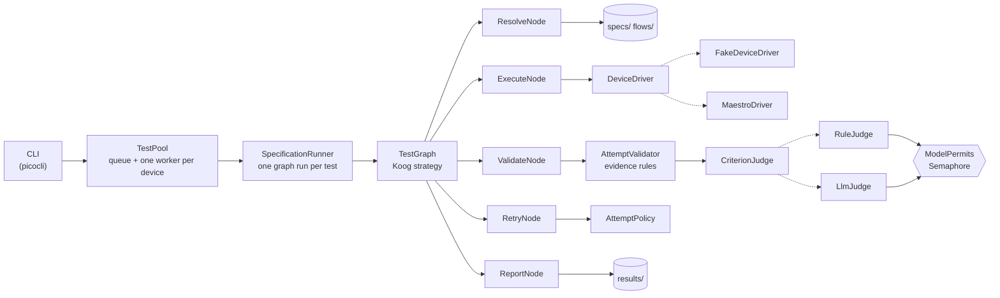
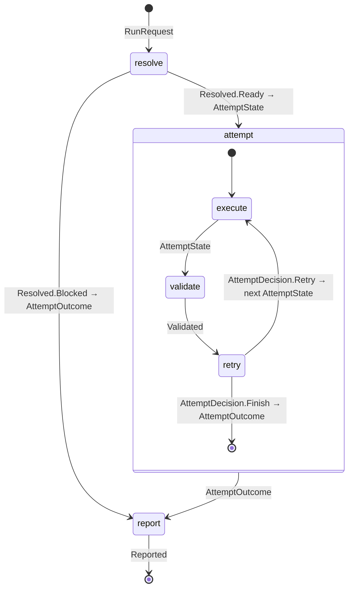
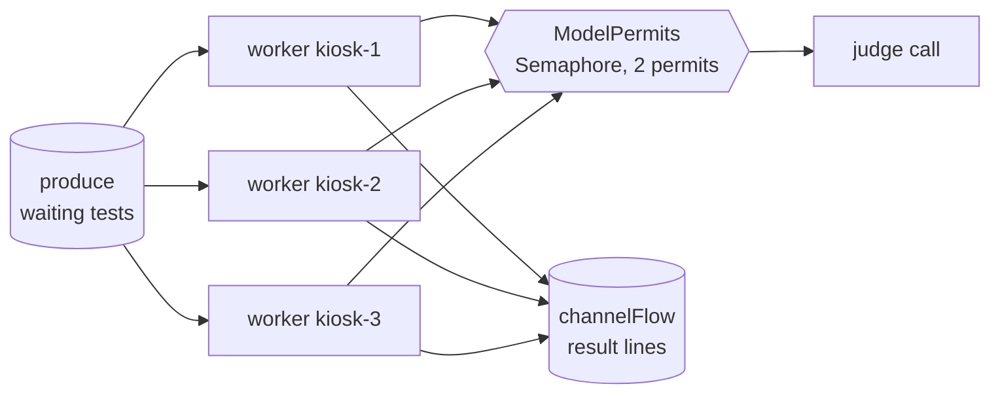

# kotlinfest2026-koog-e2e

A compact, runnable end-to-end test harness built from **typed Koog graphs**, **Spring Boot dependency injection**, a **`DeviceDriver` abstraction**, and **structured concurrency with Kotlin Coroutines**. It replays stored scenarios on devices, judges the captured evidence, retries within a budget, and leaves a record and a report for every test.

> [!IMPORTANT]
> **Disclaimer.** This is a deliberately simplified, educational project. It exists to convey design ideas, not to serve as a production harness. It runs out of the box against an in-memory fake device and a rule-based judge; the adapters for a real device (Maestro) and a real model (any OpenAI-compatible server) are included as starting points, not as supported integrations. It accompanies a KotlinFest 2026 talk and is not a product.

## Abstract

An end-to-end test on a device is slow, occasionally flaky, and often judged by a shared, rate-limited service such as an LLM. Letting a model drive the whole test makes every run different. This sample shows the alternative: the model is confined to one narrow task, and code holds everything else.

1. **Operations are stored, and code replays them.** A scenario is a JSON file of generic steps. A replay involves no model.
2. **Answers are typed, and code decides what counts.** The judge returns a structure; a ruling that cites no captured evidence is not accepted.
3. **Loops are bounded by data.** The retry loop is a Koog subgraph whose budget and deadline travel on its edges as an immutable value.
4. **Devices run in parallel; only the shared call is throttled.** One worker per device drains a queue; a semaphore limits judge calls.

## What runs today

| Part | Out of the box | Included adapter | State of the adapter |
|---|---|---|---|
| Device | `FakeDeviceDriver`, in memory | `MaestroDriver` | Unit-tested for the flow it writes; **not exercised against a device** |
| Judge | `RuleJudge`, a fixed text rule | `LlmJudge` over Koog's OpenAI client | Exercised against a local stub of an OpenAI-compatible server; **not against a real model** |

Out of scope on purpose: scenario generation, element re-location and self-repair, UI-tree digestion, screenshots as model input, account management, dashboards, tracing, persistence of graph state.

## Requirements

- JDK 21
- Network access on the first build (Gradle downloads dependencies from Maven Central)

Versions: Kotlin 2.3.21, Spring Boot 3.5.6, Koog 1.1.1, kotlinx-coroutines 1.11.0.

## Quick start

```sh
./harness doctor     # check the environment, the workspace, the devices and the judge
./harness list       # specifications and whether each has a replayable scenario
./harness run        # run every specification across three fake devices
./gradlew test       # structure, behavior, evidence-rule and concurrency tests
```

`./harness` builds the jar on first use and then runs it. Without the script: `./gradlew bootJar && java -jar build/libs/harness.jar run`.

### Commands

| Command | Purpose |
|---|---|
| `run [TEST]...` | Run tests across the devices. Progress goes to stderr; stdout carries one JSON line per test. |
| `list` | List specifications, their content hash, and the state of their scenario. |
| `graph` | Print the test graph as Mermaid, generated by Koog from the real strategy. |
| `doctor` | Check the JDK, the workspace, each device, and the judge. |
| `help [COMMAND]` | Show usage. `--help` works on every command. |

The exit code of `run` is its worst test: `0` all passed, `1` failed, `2` inconclusive, `3` review required, `4` not run, `64` unknown test.

### Configuration

Read by Spring Boot from [`application.yml`](src/main/resources/application.yml) or the environment, and bound to [`HarnessProperties`](src/main/kotlin/harness/config/HarnessProperties.kt).

| Variable | Default | Meaning |
|---|---|---|
| `HARNESS_ROOT` | `workspace` | Where `specs/`, `flows/`, `fake-device/` are read and `results/` is written |
| `HARNESS_APP_ID` | `com.example.notes` | The application under test |
| `HARNESS_BACKEND` | `fake` | `fake` or `maestro` |
| `HARNESS_DEVICES` | `kiosk-1,kiosk-2,kiosk-3` | One worker each; device serials for Maestro |
| `HARNESS_MAX_ATTEMPTS` | `3` | Attempts per test, the first included |
| `HARNESS_ATTEMPT_TIMEOUT` | `5m` | All attempts of one test together |
| `HARNESS_MODEL_PERMITS` | `2` | Judge calls in flight at once |
| `HARNESS_JUDGE` | `rule` | `rule` or `llm` |
| `HARNESS_LLM_BASE_URL`, `HARNESS_LLM_MODEL`, `HARNESS_LLM_API_KEY` | Ollama's address, `gemma3`, empty | The OpenAI-compatible server for the LLM judge |

## The workspace

A test is three files, kept apart because they change for different reasons.

**The specification**, [`workspace/specs/create-note.md`](workspace/specs/create-note.md) — what a human wants, never steps:

```markdown
# Create a note

## Goal
The user writes a new note and saves it.

## Criteria
- note-saved: After saving, the editor confirms with "Note saved".
- title-kept: The saved note shows the title "Groceries".
```

**The scenario**, [`workspace/flows/create-note.json`](workspace/flows/create-note.json) — how it is proven, as generic steps and the checkpoints that give evidence for each criterion:

```json
{
  "specId": "create-note",
  "specHash": "f1fb7836ad55970d",
  "appId": "com.example.notes",
  "steps": [
    { "type": "launch", "clearState": true },
    { "type": "tap", "target": { "id": "fab_add_note" } },
    { "type": "inputText", "text": "Groceries" },
    { "type": "tap", "target": { "text": "Save" } },
    { "type": "waitForAnimation" },
    { "type": "screenshot", "name": "01_saved" }
  ],
  "checkpoints": [{ "name": "01_saved", "criterionIds": ["note-saved", "title-kept"] }]
}
```

Steps address elements by id or label, never by coordinates. `specHash` is the digest of the specification text: edit the specification and the scenario becomes stale, which the harness reports instead of replaying it.

**The fake app**, [`workspace/fake-device/create-note.json`](workspace/fake-device/create-note.json) — only for the fake backend: how the replay behaves and what each checkpoint's screen shows.

The seven bundled specifications cover every outcome:

| Test | What happens | Outcome |
|---|---|---|
| `create-note`, `search-note` | Replay completes, evidence proves every criterion | `PASS` |
| `sync-notes` | First replay fails, the second passes | `PASS_WITH_WARNINGS` |
| `share-note` | Replay completes, the screen contradicts the criterion | `FAIL` |
| `delete-note` | Every replay fails | `INCONCLUSIVE` |
| `archive-note` | The scenario's hash no longer matches the specification | `REVIEW_REQUIRED` |
| `export-note` | No scenario is stored | `NOT_RUN` |

## Architecture



| Box | Code |
|---|---|
| CLI | [`cli/`](src/main/kotlin/harness/cli) |
| TestPool, result lines | [`pool/TestPool.kt`](src/main/kotlin/harness/pool/TestPool.kt), [`pool/ResultLine.kt`](src/main/kotlin/harness/pool/ResultLine.kt) |
| SpecificationRunner, agent creation | [`graph/SpecificationRunner.kt`](src/main/kotlin/harness/graph/SpecificationRunner.kt), [`graph/AgentFactory.kt`](src/main/kotlin/harness/graph/AgentFactory.kt) |
| TestGraph, AttemptSubgraph | [`graph/TestGraph.kt`](src/main/kotlin/harness/graph/TestGraph.kt), [`graph/AttemptSubgraph.kt`](src/main/kotlin/harness/graph/AttemptSubgraph.kt) |
| Nodes | [`graph/node/`](src/main/kotlin/harness/graph/node) |
| Specifications, scenarios | [`spec/`](src/main/kotlin/harness/spec), [`scenario/`](src/main/kotlin/harness/scenario) |
| DeviceDriver and its two implementations | [`device/DeviceDriver.kt`](src/main/kotlin/harness/device/DeviceDriver.kt), [`device/fake/`](src/main/kotlin/harness/device/fake), [`device/maestro/`](src/main/kotlin/harness/device/maestro) |
| AttemptValidator, AttemptPolicy, outcome rules | [`run/AttemptValidator.kt`](src/main/kotlin/harness/run/AttemptValidator.kt), [`run/AttemptPolicy.kt`](src/main/kotlin/harness/run/AttemptPolicy.kt), [`run/OutcomeRules.kt`](src/main/kotlin/harness/run/OutcomeRules.kt) |
| CriterionJudge and its two implementations, ModelPermits | [`judge/`](src/main/kotlin/harness/judge) |
| Spring wiring | [`config/HarnessConfiguration.kt`](src/main/kotlin/harness/config/HarnessConfiguration.kt) |

### Division of responsibility

| Layer | Responsible for | Not responsible for |
|---|---|---|
| **Spring Boot** | Building the object graph by constructor injection; choosing the device backend and the judge from configuration; process start and exit code | Control flow of a test; concurrency |
| **Koog** | The typed graph: nodes, edges, conditions, the subgraph boundary; executing one run; structured output and its repair; graph assertions in tests | What a node does; how many runs happen at once |
| **Coroutines** | Distributing tests to workers, collecting results, limiting the shared call, timeouts, cancellation | The steps inside a test |
| **Sample code** | Node bodies, the retry policy, the evidence rules, the device seam, the fakes, the CLI | — |

## The graph



| Element | Code |
|---|---|
| Top-level strategy `test-run` | [`graph/TestGraph.kt`](src/main/kotlin/harness/graph/TestGraph.kt) |
| Subgraph `attempt` | [`graph/AttemptSubgraph.kt`](src/main/kotlin/harness/graph/AttemptSubgraph.kt) |
| `resolve`: may the test touch the device? | [`graph/node/ResolveNode.kt`](src/main/kotlin/harness/graph/node/ResolveNode.kt) |
| `execute`: replay, with the deadline | [`graph/node/ExecuteNode.kt`](src/main/kotlin/harness/graph/node/ExecuteNode.kt) |
| `validate`: judge from stored evidence | [`graph/node/ValidateNode.kt`](src/main/kotlin/harness/graph/node/ValidateNode.kt) |
| `retry`: finish or go again | [`graph/node/RetryNode.kt`](src/main/kotlin/harness/graph/node/RetryNode.kt) |
| `report`: record and report | [`graph/node/ReportNode.kt`](src/main/kotlin/harness/graph/node/ReportNode.kt) |
| Inputs, outputs, branches | [`graph/Model.kt`](src/main/kotlin/harness/graph/Model.kt) |

`./harness graph` prints the diagram Koog derives from the same strategy object.

### Why a subgraph

The retry loop is a self-contained protocol: it takes a ready attempt and yields a final outcome. Folding it into one subgraph gives it a typed boundary (`AttemptState` in, `AttemptOutcome` out). The top level stays three nodes and reads as the outline of a test, and the loop can be asserted on its own.

### State is passed, not shared

A subgraph does **not** provide shared mutable state, and this sample does not pretend it does. Where the loop stands is one immutable value:

```kotlin
data class AttemptState(
    val context: RunContext,
    val scenario: Scenario,
    val attemptNumber: Int,
    val retriesRemaining: Int,
    val previousAttempts: List<AttemptRecord> = emptyList(),
    val currentEvidence: ExecutionResult? = null,
    val deadline: Instant,
    …
)
```

`resolve` creates it. `execute` returns a copy carrying the evidence. `validate` returns a copy with the judged attempt appended. On a retry, `retry` returns `state.copy(attemptNumber + 1, retriesRemaining - 1)` inside `AttemptDecision.Retry`, and the `Retry` edge hands that value back to `execute`. There is no counter in a field, in the subgraph, or in the agent, and no conversation history. Because each pass decreases the budget and the deadline never moves, the loop always ends.

Node bodies are ordinary classes that know nothing of Koog ([`GraphNode`](src/main/kotlin/harness/graph/GraphNode.kt)); they meet Koog in one place, `asNode()`.

## Code decides what counts

The judge's answer is a claim. [`AttemptValidator`](src/main/kotlin/harness/run/AttemptValidator.kt) turns it into a verdict in four phases:

1. **Evidence check.** Nothing captured, or a file that no longer matches its digest: the judge is not asked.
2. **Ask the judge**, giving it only stored evidence, never the live device.
3. **Shape check.** A duplicate or unknown criterion id is a harness fault, not a verdict.
4. **Evidence rules.** A `PASS` or `FAIL` that cites no captured checkpoint becomes `INCONCLUSIVE`; a criterion the judge skipped is not verified.

Then [`OutcomeRules`](src/main/kotlin/harness/run/OutcomeRules.kt) aggregates and [`AttemptPolicy`](src/main/kotlin/harness/run/AttemptPolicy.kt) decides what follows: a pass or a fail is final (evidence decided it), a harness fault is final, and only a transient failure is retried.

These rules hold whichever judge is plugged in. With the LLM judge, Koog requests the answer as a typed structure ([`JudgedRun`](src/main/kotlin/harness/judge/LlmJudge.kt)) and repairs a malformed one a bounded number of times.

## Worked example

```text
$ ./harness run create-note sync-notes share-note
   365ms  kiosk-1   create-note    replay >  attempt 1/3
   369ms  kiosk-2   sync-notes     replay >  attempt 1/3
   369ms  kiosk-3   share-note     replay >  attempt 1/3
   630ms  kiosk-2   sync-notes     replay <  step 2 failed: the device was busy
   634ms  kiosk-2   sync-notes     retry     step 2 failed: the device was busy
   636ms  kiosk-2   sync-notes     replay >  attempt 2/3
   996ms  kiosk-3   share-note     evidence  01_shared
   998ms  kiosk-3   share-note     judge >   1/2 permits in use
  1128ms  kiosk-2   sync-notes     judge >   2/2 permits in use
  1605ms  kiosk-3   share-note     judge <   FAIL
  1617ms  kiosk-1   create-note    judge >   2/2 permits in use
  1621ms  kiosk-3   share-note     RESULT    FAIL after 1 attempt(s)
  1736ms  kiosk-2   sync-notes     RESULT    PASS_WITH_WARNINGS after 2 attempt(s)
  2220ms  kiosk-1   create-note    RESULT    PASS after 1 attempt(s)
```

(Abridged; timings vary by a few milliseconds.) Three things are visible: all three devices replay at once; `create-note` finishes its replay at about 1126 ms but waits until 1617 ms for a judge permit; and `share-note` fails after one attempt without a retry, because evidence contradicted the criterion.

Stdout carries one line per test:

```json
{"testId":"share-note","outcome":"FAIL","exitCode":1,"device":"kiosk-3","attempts":1,"reason":"criterion link-created: the screen does not show \"Link copied\"","record":"workspace/results/…/share-note/record.json","report":"workspace/results/…/share-note/report.md"}
```

Each test leaves `record.json` (the full typed record), `report.md` (a readable summary with each criterion's ruling and evidence), and one directory per attempt with the device log and the captured evidence.

## The device seam

[`DeviceDriver`](src/main/kotlin/harness/device/DeviceDriver.kt) is the only thing the graph knows about a device: readiness, and `execute(scenario, attemptDir, listener)` returning an `ExecutionResult`. A failed step is data in that result, not an exception, so the attempt loop can route on it.

Each backend translates the sealed [`FlowStep`](src/main/kotlin/harness/scenario/FlowStep.kt) with a `when` that has no `else`. [`MaestroStepWriter`](src/main/kotlin/harness/device/maestro/MaestroStepWriter.kt) is the example: add a step type and forget it there, and the build fails.

What the fake lets you verify: every branch of the graph, the retry policy and its exact number of replays, the evidence rules, and the scheduling of workers — in milliseconds, on every merge request. What it cannot tell you: anything about a real device.

## Testing: structure versus behavior

| | Structure | Behavior |
|---|---|---|
| Question | Is the graph wired as designed? | Does a run produce the right outcome? |
| Method | Koog's testing feature (`testGraph`, `assertNodeByName`, `assertEdges`, `assertReachable`) | Execute the real graph on `FakeDeviceDriver` and `RuleJudge` |
| Runs node bodies | No | Yes |
| Catches | A missing node, a wrong input or output type, an edge to the wrong node | A wrong policy, an off-by-one in the budget, a missing record |
| Test | [`GraphStructureTest`](src/test/kotlin/harness/GraphStructureTest.kt) | [`GraphBehaviorTest`](src/test/kotlin/harness/GraphBehaviorTest.kt) |

The two are complementary: a correctly wired graph can still decide wrongly, and a correct rule is useless if no edge leads to it. Types are checked by the compiler, but an edge condition is evaluated at run time, so "every branch leads somewhere" needs the structure test.

The rest of the safety net:

| Test | Subject |
|---|---|
| [`AttemptValidatorTest`](src/test/kotlin/harness/AttemptValidatorTest.kt) | The evidence rules, against a judge stub that answers as a model might |
| [`AttemptPolicyTest`](src/test/kotlin/harness/AttemptPolicyTest.kt) | Each branch of the retry policy, as a plain class |
| [`TestPoolTest`](src/test/kotlin/harness/TestPoolTest.kt) | Overlap, the permit limit, failure isolation, cancellation |
| [`MaestroTest`](src/test/kotlin/harness/MaestroTest.kt) | The flow the driver writes; process timeout and cancellation |
| [`SpecificationParserTest`](src/test/kotlin/harness/SpecificationParserTest.kt), [`ApplicationWiringTest`](src/test/kotlin/harness/ApplicationWiringTest.kt) | The specification format; the Spring context |

[`Wiring`](src/test/kotlin/harness/Wiring.kt) builds the production object graph by hand with plain constructors, which is what constructor injection buys in tests.

## Concurrency model



```text
runBlocking                 // CLI
└─ channelFlow              // results as one Flow
   ├─ produce               // the queue
   ├─ launch                // worker of kiosk-1
   │  └─ withTimeoutOrNull  // the test's deadline, around the replay
   └─ launch                // worker of kiosk-2
```

- **Queue.** The waiting tests are one channel ([`TestPool`](src/main/kotlin/harness/pool/TestPool.kt)). A worker takes the next test when it is free, so a slow test never blocks another device.
- **Workers.** One coroutine per device. A worker owns its device, so devices need no lock, and each test is an independent graph run with a fresh Koog agent.
- **Semaphore.** Only the judge call goes through [`ModelPermits`](src/main/kotlin/harness/judge/ModelPermits.kt). It limits how many calls are in flight, not requests per minute.
- **Timeouts.** The deadline in `AttemptState` becomes a `withTimeoutOrNull` around the replay. [`ProcessRunner`](src/main/kotlin/harness/device/maestro/ProcessRunner.kt) waits for an external tool under `runInterruptible`, so the same cancellation reaches a `maestro` process.
- **Structured concurrency.** The queue and the workers are children of the collector's scope. Cancelling the collector cancels them all, down to a replay in flight. No global scope is used and no `CancellationException` is swallowed.
- **Failure isolation.** A fault inside one graph run is caught by [`SpecificationRunner`](src/main/kotlin/harness/graph/SpecificationRunner.kt), recorded as `INCONCLUSIVE` for that test, and does not reach the others.

## Going beyond the fakes

**A real model.** Any OpenAI-compatible server works, for example a local Ollama:

```sh
HARNESS_JUDGE=llm HARNESS_LLM_MODEL=<model> ./harness doctor
HARNESS_JUDGE=llm HARNESS_LLM_MODEL=<model> ./harness run create-note
```

The judge reads hierarchy text only; screenshots are not sent. Nodes and rules are unchanged: only the `CriterionJudge` bean differs.

**A real device.** Point the harness at an app and a device Maestro can see, and write specifications and scenarios for that app:

```sh
HARNESS_BACKEND=maestro HARNESS_DEVICES=<serial> HARNESS_APP_ID=<app id> HARNESS_ROOT=<your workspace> ./harness doctor
```

Expect to adjust [`MaestroDriver`](src/main/kotlin/harness/device/maestro/MaestroDriver.kt): it has not been run against a device in this sample, and its failure parsing is a first approximation.

## Differences from the talk

| In the talk | In this sample |
|---|---|
| Scenarios are generated by a model exploring the app | Scenarios are written by hand |
| A missing element triggers a bounded model-driven recovery (`locate → patch`) | No recovery; a failed step is retried unchanged, then inconclusive |
| Maestro and Appium drivers, used daily | A fake driver, plus a minimal Maestro driver that is untested on devices |
| A model judges screenshots and digested hierarchies | A rule judge, plus an LLM judge reading hierarchy text only |
| Reports, a dashboard, tracing | A JSON record and a Markdown report per test |

## Limitations

This sample makes no claim about:

- behavior on real devices, or correctness of the Maestro driver;
- quality, cost, latency or rate limits of a real model, or the quality of the judge prompt;
- fairness or ordering of test distribution beyond "each test runs once";
- secrets: nothing redacts what a model or a device log writes into records;
- durability: an interrupted run leaves no record for the tests in flight;
- suitability for production use of any kind.
